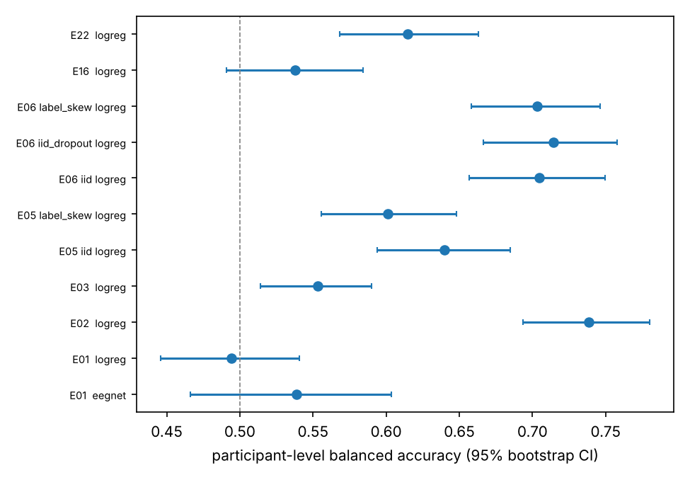
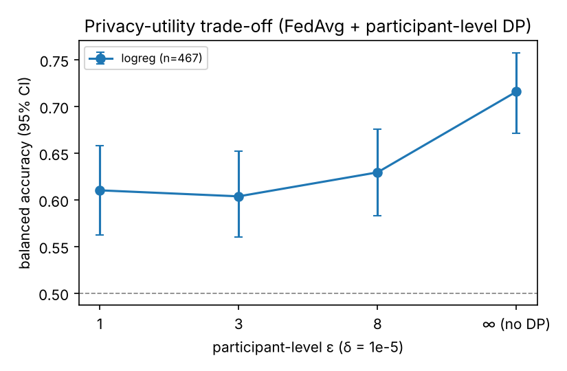

# REPORT — Federated, participant-level DP EEG classification of MDD on TDBRAIN

_Auto-generated by `make report` from the logged MLflow runs (src/report/tables.py). Do not edit by hand._

> **Research benchmark, not a diagnostic tool.** No model or EEG feature here is a clinical test or a biomarker of depression.

## 1. Cohort

Participants 1303 → first session 1303 → with restEC 1299 → labelled (not blinded/UNKNOWN) 1044 → T1 475, T2 644. Rules: {'age_min': 18, 'age_max': 65, 'exclude_comorbid_mdd': False, 'primary_task': 'T1', 'min_healthy_for_t1': 50, 't2_other_groups': None}.

| task | class | n | age mean (SD) | sex (raw codes) | comorbid |
|---|---|---|---|---|---|
| T1 | MDD | 313 | 43.4 (12.1) | 0: 162, 1: 151 | 28 |
| T1 | HEALTHY | 162 | 36.9 (14.1) | 0: 93, 1: 69 | 0 |
| T2 | MDD | 313 | 43.4 (12.1) | 0: 162, 1: 151 | 28 |
| T2 | OTHER | 331 | 43.8 (13.7) | 1: 184, 0: 147 | 24 |

QC: 10/806 participants excluded (1.2%), epoch rejection 8.2%, 28 recordings with within-recording interpolation (37 channels). Eyes-closed alpha O1/O2 > Fp1/Fp2 in 95% of participants.

## 2. Main results (participant-level, out-of-fold, seed-averaged; 2,000-resample bootstrap CIs)

| exp | variant | model | regime | task | ε | n | BA [95% CI] | AUC [95% CI] | BA mean±SD (folds×seeds) | worst client BA |
|---|---|---|---|---|---|---|---|---|---|---|
| E01 | default | eegnet | central | T1 | inf | 94 | 0.539 [0.466, 0.603] | 0.535 [0.402, 0.658] | 0.539 ± 0.000 | — |
| E01 | default | logreg | central | T1 | inf | 467 | 0.494 [0.446, 0.541] | 0.457 [0.402, 0.512] | 0.479 ± 0.046 | — |
| E02 | default | logreg | central | T1 | inf | 467 | 0.738 [0.693, 0.780] | 0.768 [0.720, 0.814] | 0.737 ± 0.047 | — |
| E03 | default | logreg | central | T2 | inf | 640 | 0.553 [0.514, 0.590] | 0.581 [0.536, 0.624] | 0.553 ± 0.016 | — |
| E05 | iid | logreg | local | T1 | inf | 467 | 0.640 [0.594, 0.685] | 0.695 [0.643, 0.746] | 0.639 ± 0.032 | 0.620 |
| E05 | label_skew | logreg | local | T1 | inf | 467 | 0.601 [0.555, 0.648] | 0.604 [0.550, 0.657] | 0.600 ± 0.037 | 0.592 |
| E06 | iid | logreg | federated | T1 | inf | 467 | 0.705 [0.657, 0.750] | 0.766 [0.717, 0.811] | 0.692 ± 0.036 | — |
| E06 | iid_dropout | logreg | federated | T1 | inf | 467 | 0.714 [0.666, 0.758] | 0.769 [0.722, 0.812] | 0.714 ± 0.052 | — |
| E06 | label_skew | logreg | federated | T1 | inf | 467 | 0.703 [0.658, 0.746] | 0.764 [0.714, 0.809] | 0.704 ± 0.081 | — |
| E09 | default | logreg | federated | T1 | 1 | 467 | 0.610 [0.562, 0.658] | 0.641 [0.584, 0.693] | 0.609 ± 0.048 | — |
| E09 | default | logreg | federated | T1 | 3 | 467 | 0.604 [0.560, 0.652] | 0.639 [0.583, 0.693] | 0.602 ± 0.020 | — |
| E09 | default | logreg | federated | T1 | 8 | 467 | 0.629 [0.583, 0.676] | 0.688 [0.637, 0.737] | 0.627 ± 0.027 | — |
| E09 | default | logreg | federated | T1 | inf | 467 | 0.716 [0.671, 0.758] | 0.767 [0.718, 0.814] | 0.715 ± 0.062 | — |
| E16 | default | logreg | central | T1 | inf | 467 | 0.538 [0.491, 0.584] | 0.536 [0.477, 0.594] | 0.539 ± 0.030 | — |
| E22 | default | logreg | central | T1 | inf | 467 | 0.615 [0.568, 0.663] | 0.635 [0.580, 0.693] | 0.614 ± 0.022 | — |

E01 (shuffled labels) must be ≈ 0.5. E12 is a DELIBERATELY WRONG segment-level split and only shows how much leakage inflates scores.

### Paired comparisons (A − B on common participants; paired bootstrap 95% CI; no p-values)

| comparison | metric | A − B [95% CI] | n_participants |
|---|---|---|---|
| LR FedAvg IID - LR central | balanced_accuracy | -0.034 [-0.066, -0.005] | 467 |
| LR FedAvg IID - LR central | auc | -0.002 [-0.022, 0.018] | 467 |
| LR FedAvg label-skew - IID | balanced_accuracy | -0.002 [-0.037, 0.032] | 467 |
| LR FedAvg label-skew - IID | auc | -0.003 [-0.023, 0.016] | 467 |
| FAA only - full LR | balanced_accuracy | -0.201 [-0.262, -0.137] | 467 |
| FAA only - full LR | auc | -0.232 [-0.300, -0.161] | 467 |
| Band power LR - age-only LR | balanced_accuracy | 0.123 [0.067, 0.180] | 467 |
| Band power LR - age-only LR | auc | 0.133 [0.071, 0.194] | 467 |
| logreg DP eps=1 - non-DP | balanced_accuracy | -0.106 [-0.160, -0.051] | 467 |
| logreg DP eps=1 - non-DP | auc | -0.126 [-0.186, -0.064] | 467 |
| logreg DP eps=3 - non-DP | balanced_accuracy | -0.112 [-0.164, -0.058] | 467 |
| logreg DP eps=3 - non-DP | auc | -0.128 [-0.184, -0.072] | 467 |
| logreg DP eps=8 - non-DP | balanced_accuracy | -0.086 [-0.133, -0.040] | 467 |
| logreg DP eps=8 - non-DP | auc | -0.078 [-0.120, -0.036] | 467 |

## 3. Privacy

Threat model: an honest-but-curious server, or anyone with query access to the released model, tries to infer whether a participant was in training. The privacy unit is the **participant**: ε is the participant-level guarantee for each client's released updates (max over clients). The epoch-level ε is shown only for comparison; it is what a per-sample accountant would report and is **not** a participant guarantee.

| model | eps | n_participants | BA [95% CI] | AUC [95% CI] | achieved participant ε (mean) | epoch-level ε (reference only) |
|---|---|---|---|---|---|---|
| logreg | 1 | 467 | 0.610 [0.562, 0.658] | 0.641 [0.584, 0.693] | 1.000 | 1.000 |
| logreg | 3 | 467 | 0.604 [0.560, 0.652] | 0.639 [0.583, 0.693] | 2.999 | 2.999 |
| logreg | 8 | 467 | 0.629 [0.583, 0.676] | 0.688 [0.637, 0.737] | 7.995 | 7.995 |
| logreg | inf | 467 | 0.716 [0.671, 0.758] | 0.767 [0.718, 0.814] | — | — |

### LiRA membership-inference audit (participant level)

| model | regime | eps | achieved_epsilon | auc | tpr_at_fpr_0.01 | tpr_at_fpr_0.05 | tpr_at_fpr_0.001 | n_nonmember_evals | sanity_auc_nonmembers_only | n_models |
|---|---|---|---|---|---|---|---|---|---|---|
| logreg | central | inf | — | 0.590 | 0.017 | 0.075 | 0.002 | 3744 | 0.485 | 16 |
| logreg | federated | inf | — | 0.563 | 0.023 | 0.089 | 0.005 | 3744 | 0.512 | 16 |
| logreg | federated | 1 | 1.000 | 0.507 | 0.014 | 0.054 | 0.002 | 3744 | 0.498 | 16 |
| logreg | federated | 3 | 2.999 | 0.499 | 0.013 | 0.059 | 0.000 | 3744 | 0.509 | 16 |
| logreg | federated | 8 | 7.995 | 0.524 | 0.014 | 0.064 | 0.001 | 3744 | 0.489 | 16 |

## 4. External test (TDBRAIN → Mumtaz, frozen models, evaluated once)

## 5. Limitations

- Age differs between classes (see the cohort table); E22 shows how far age alone separates them, and band-power features are age-dependent, so part of the T1 signal may be age.
- Simulated clients are random partitions of one archive, **not hospitals**; real sites differ in hardware, protocol and population.
- The external set (Mumtaz) is small; its CIs are wide.
- Medication was not systematically tracked in TDBRAIN and alters the EEG spectrum.
- Diagnostic labels are noisy (clinical-practice indications; comorbidity).
- Results on subject-level splits only; segment-level numbers (E12) are a leakage demonstration.
- **Not a diagnostic tool.** Explainability outputs explain the model, not the disorder.

## 6. Reproducibility

git commit `d08de409c0bcdb5032f0326bc9c95dae18b64235`, split hash `758ada32a67740bf199d043d4c9b09e066d777308764de5456c6292336e33fee`, participants.tsv hash `['08fc8feb28f99d9d0ab56026a9f02c1cc80870a9385a3dffcea322fcd8051fe4']`, seeds ['0', '1', '2'], 152 MLflow runs. Packages: {'numpy': '2.2.6', 'scipy': '1.17.1', 'pandas': '3.1.1', 'scikit-learn': '1.9.1', 'torch': '2.15.0', 'flwr': '1.44.0', 'opacus': '1.6.0', 'mne': '1.13.2', 'mlflow': '3.18.0', 'streamlit': '1.67.0', 'plotly': '7.2.0'}.
