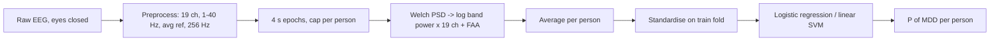
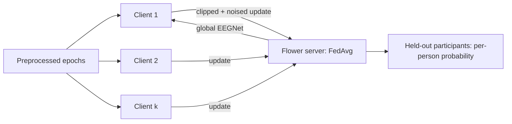
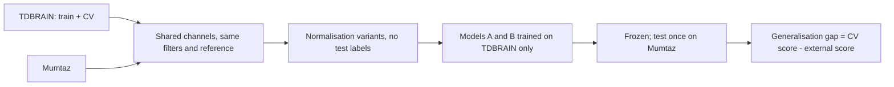
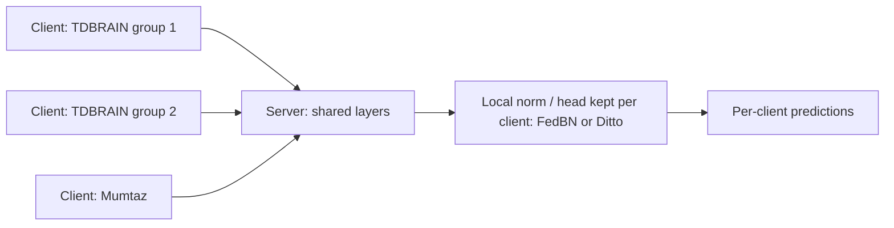
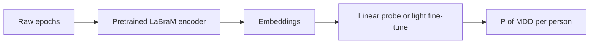
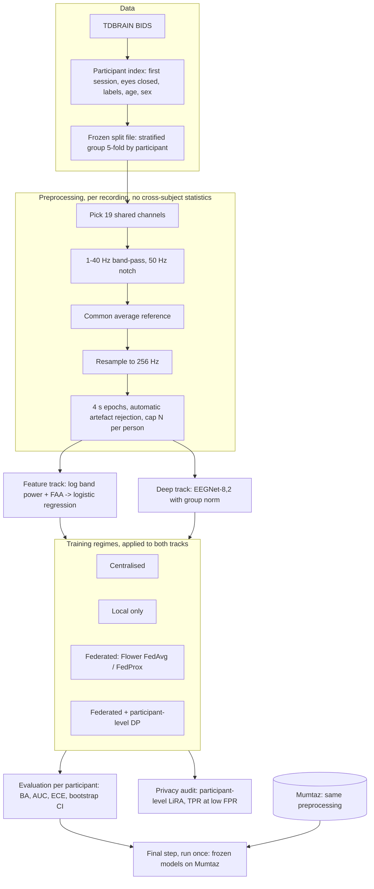

# EEG-Based MDD Minor Project — Research & Architecture Plan

&#32;

## 1. Executive summary

**Recommendation:** turn the project into a leakage-safe benchmark on TDBRAIN. It compares a qEEG-feature baseline with EEGNet under four training regimes: centralised, local-only, federated, and federated with participant-level differential privacy. The frozen models are then tested once on the Mumtaz dataset as an external check. The eight agents, the 32-channel interpolation, ComBat, asynchronous FL and the fixed accuracy targets should all be dropped.

Why this direction, in four findings from the literature:

- **Splitting EEG by segment instead of by person inflates accuracy.** A 2024 study found most deep-learning EEG papers do this ([Brookshire et al., 2024](https://www.frontiersin.org/journals/neuroscience/articles/10.3389/fnins.2024.1373515/full)). DeprNet reported 99.37% with a record-wise split and 91.4% with a subject-wise split on the same data.
- **Frontal alpha asymmetry (FAA) is not a diagnostic biomarker.** A meta-analysis found a negligible, non-significant effect size ([van der Vinne et al., 2017](https://pubmed.ncbi.nlm.nih.gov/28761811/)).
- **Cross-dataset replication is weak.** Alpha-band markers averaged 57.3% accuracy on one public MDD dataset and 51.0% on another ([Hollenbenders et al., 2024 preprint](https://medrxiv.org/content/10.1101/2024.11.11.24317109v1.full.pdf)).
- **TDBRAIN's own curators count a diagnostic model as successful above 60% balanced accuracy** on their held-out data ([TDBRAIN Challenge](https://brainclinics.com/tdbrain-challenge/)). The proposal's 78% target has no evidence behind it.

**Dataset status:**

| Dataset | Status | Role |
| --- | --- | --- |
| TDBRAIN | Verified from the data descriptor: 1,274 participants, 426 MDD, 26 channels, 500 Hz, 2 min eyes-open + 2 min eyes-closed | Main training and evaluation data |
| Mumtaz (figshare 4244171) | Verified from secondary sources: 34 MDD, 30 healthy, 19 channels, 256 Hz, 5 min eyes-closed | One-time external test |
| ICMR folder | Raw EDF seen for 1–2 people: 31 channels, 1000 Hz, \~12 min, plus derived feature CSVs | Parked until there are more labelled recordings |
| qEEG ("QEZ") folder | Not identified: contents, source and labels unknown | Parked |

**The contribution, stated honestly:**

1. A reproducible, subject-level benchmark on a large clinical archive.
2. A measured cost of federated training and of participant-level privacy, compared with centralised training.
3. A cross-dataset transfer result.
4. A correctly specified privacy audit.

All four stay valid even if accuracy turns out modest. That is the main reason to prefer this design over the original.

**Decisions only clinicians can make** are listed in section 15. The most urgent: which TDBRAIN participants count as "healthy", and whether 2 minutes of eyes-closed EEG is enough per person.

## 2. Biological and EEG background for an engineering student

EEG reliably measures the brain's electrical rhythms, but no rhythm has been shown to diagnose depression. Everything below is textbook neurophysiology unless it is marked as debated.

### 2.1 The signal

| Concept | Plain explanation | Engineering analogy |
| --- | --- | --- |
| What the brain does during EEG | Neurons pass tiny electrical currents. When millions of neurons in the outer layer of the brain (the cortex) are active in sync, their currents add up enough to reach the scalp. EEG records that sum, never single neurons. | A microphone outside a stadium. You can't hear one person, only the crowd chanting together. |
| Electrode | A small metal (usually Ag/AgCl) disc on the scalp. It measures voltage, in microvolts (µV), relative to a reference point. | A voltmeter whose second probe is fixed on the reference. |
| Channel | One electrode's voltage over time. Names encode location: Fp/F frontal, C central, T temporal, P parietal, O occipital; odd numbers are left, even are right, z is the midline. | One column of a multivariate time series, tagged with a position on the head. |
| Reference | The point every channel is measured against: mastoids, linked ears, Cz or the average of all channels. Changing it changes every channel. | Measuring heights from sea level versus from the floor of the room. |
| Sampling frequency | Samples per second, in Hz. At 500 Hz each channel gives 500 numbers per second. A rate f\_s can represent rhythms up to f\_s/2, so 256 Hz is plenty for activity below 40 Hz. | The frame rate of a video. |
| Frequency bands | EEG is decomposed into rhythms by their speed (Fourier analysis). Band edges are conventions and differ between papers. | An audio equalizer splitting sound into bass, mid and treble. |
| Delta (\~0.5–4 Hz) | Dominant in deep sleep. In an awake adult, a lot of delta often means drowsiness or artefact. | Very low-frequency drift. |
| Theta (\~4–8 Hz) | Drowsiness, some memory and attention processes. |  |
| Alpha (\~8–13 Hz) | The idling rhythm of an awake, relaxed brain. Strongest over the back of the head with eyes closed. | A CPU's idle loop. |
| Beta (\~13–30 Hz) | Active, alert thinking. Also inflated by muscle tension and some medications (e.g. benzodiazepines). |  |
| Gamma (>30 Hz) | Fast activity. On the scalp it is heavily contaminated by muscle noise, so treat it with suspicion. | A high-frequency band where the sensor noise floor dominates. |
| Resting state | EEG recorded while the person sits quietly with no task. | A machine's idle power draw, measured before any job runs. |
| Eyes open vs eyes closed | Closing the eyes sharply increases posterior alpha (the Berger effect). The two conditions are different signals, so never mix them in one analysis. | Two operating modes of the same device. |

### 2.2 Why the data is messy

- **Artefacts** are any recorded signal that doesn't come from the brain:
  - Eye blinks and eye movements: large, slow, frontal.
  - Muscle activity: fast, mainly temporal.
  - Heartbeat (ECG).
  - 50 Hz mains interference (India, Malaysia and the Netherlands all use 50 Hz).
  - Sweat drift and loose electrodes.
- **People differ a lot**, because of:
  - Skull thickness.
  - Age: alpha slows with age, and children look very different from adults. TDBRAIN spans ages 5–88.
  - Sex.
  - Medication, caffeine, nicotine, sleepiness.
  - Exact electrode placement.
- **EEG is a personal fingerprint.** It is individual enough to identify people. That is why letting segments from the same person into both training and test data inflates accuracy: the model recognises the person, not the disorder.
- **Hospitals and datasets differ** in amplifier, cap, reference, filters, recording length, instructions, patient mix and how diagnoses were made. A model can learn "which site" instead of "which condition". Engineers call this distribution shift or domain shift.

### 2.3 The clinical side

- **Major depressive disorder (MDD)** is diagnosed from symptoms, using DSM-5 or ICD criteria. Roughly, it means two or more weeks of low mood or loss of interest, plus other symptoms such as sleep, appetite or concentration changes. It is not defined by any brain measurement. Two patients with MDD can share very few symptoms, so the group is biologically mixed.
- **A clinical diagnosis** is a clinician's judgement, made from an interview against those criteria. Different raters don't always agree, so labels carry noise.
- **A healthy control** is a person screened as not having the disorder, ideally no psychiatric disorder at all. How strictly they were screened varies. In TDBRAIN, a missing diagnosis is marked UNKNOWN, and the curators state this does not mean healthy ([van Dijk et al., 2022](https://www.nature.com/articles/s41597-022-01409-z)).
- **A clinical comparison group** is patients with other conditions, such as ADHD or OCD. MDD vs other patients is harder than MDD vs healthy, but closer to the question a clinic actually faces.
- **Frontal alpha asymmetry (FAA)** is defined as ln(alpha power at F4) − ln(alpha power at F3). It comes from an approach/withdrawal theory of emotion. A meta-analysis found a negligible diagnostic effect, with direction varying by age, sex and severity ([van der Vinne et al., 2017](https://pubmed.ncbi.nlm.nih.gov/28761811/)). A five-study multiverse analysis found no relationship with depressive disorders ([Kołodziej et al., eLife 2021](https://pmc.ncbi.nlm.nih.gov/articles/PMC8154036)).
- **What EEGNet does** with a recording, in order:
  1. It learns its own band-pass filters (temporal convolutions), much like choosing frequency bands.
  2. For each filter it learns weighted mixtures of electrodes (depthwise spatial convolutions), much like choosing brain regions.
  3. It summarises how those filtered mixtures behave over time and classifies them.

  In effect it learns "which rhythms, at which electrode combinations" separate the classes. Details are in section 5.

### 2.4 Levels of evidence

| Level | Meaning | Status for MDD diagnosis |
| --- | --- | --- |
| Associated with MDD in some studies | A group difference reported in at least some samples | Yes: alpha, theta and beta power, FAA, connectivity, complexity measures. Findings conflict across studies ([de Aguiar Neto & Rosa, 2019](https://repositorio.usp.br/item/002957486)). |
| Reproducible marker | The same direction and size of effect in independent, large samples | Not established. Cross-dataset replication of alpha markers was "rather inconsistent" ([Hollenbenders et al., 2024](https://medrxiv.org/content/10.1101/2024.11.11.24317109v1.full.pdf)). |
| Clinically validated diagnostic biomarker | Prospectively validated, with known accuracy in the intended clinical population | None. An APA task-force meta-analysis concluded QEEG is not clinically reliable even for predicting treatment response ([Widge et al., 2019](https://ajp.psychiatryonline.org/doi/10.1176/appi.ajp.2018.17121358)). |

**Well established:** what EEG measures, the eyes-closed alpha increase, the main artefact types, age effects, and the 50 Hz line noise. **Debated:** any EEG signature specific to MDD.

### 2.5 Who decides what

| You can decide as the ML engineer | Needs a clinician or neurophysiologist |
| --- | --- |
| Train/test splitting, metrics, models, hyperparameters | Which participants count as MDD, healthy, or excluded (comorbidity, medication, age range) |
| Filter settings within standard ranges, epoch length, resampling | Whether 2 min of eyes-closed data per person is adequate, and which recordings to reject on quality |
| Federated setup, differential privacy, the privacy audit | Whether an artefact-rejection rule throws away real brain signal |
| Choosing a common channel set by intersection | Interpreting which features matter, and every clinical claim |

## 3. Dataset investigation and compatibility

Only TDBRAIN and Mumtaz are usable now, and they can't simply be pooled. Train on TDBRAIN and use Mumtaz once, as an external test.

### 3.1 What is verified

| Property | TDBRAIN | Mumtaz (figshare 4244171) | ICMR folder | qEEG ("QEZ") folder |
| --- | --- | --- | --- | --- |
| Source | [van Dijk et al., Sci Data 2022](https://www.nature.com/articles/s41597-022-01409-z) | Mumtaz et al., Hospital Universiti Sains Malaysia ([dataset listing](https://huggingface.co/datasets/EEGDash/nm000114/blob/main/README.md)) | Unknown study or hospital; ICMR is a funder, not a dataset name | Unknown |
| Participants | 1,274 (1,346 sessions). Indications: MDD 426, ADHD 271, SMC 119, OCD 75. Healthy count not given in the paper. | 34 MDD, 30 healthy. Some files are missing in practice (one paper used 30 MDD and 28 healthy for eyes-closed) | 1–2 recordings seen | Unknown |
| Channels | 26 EEG channels (10–10 system), plus extra non-EEG channels; exact list to confirm from `channels.tsv` | 19 EEG channels (10–20 system); files hold 20–22 channels including non-EEG ones | 31 (32-channel cap layout, Cz absent) | Unknown |
| Sampling rate | 500 Hz | 256 Hz | 1000 Hz | Unknown |
| Reference | Averaged mastoids (offline); ground at AFz | Linked ears | Unknown (possibly Cz) | Unknown |
| Conditions | 2 min eyes open + 2 min eyes closed | \~5 min eyes closed, \~5 min eyes open, plus a P300 task | \~12 min; folder also contains Stroop/Task files, so possibly task EEG | Unknown |
| Labels | `participants.tsv` indication column. About 30% of MDD/ADHD/OCD labels are blinded (IDs starting `sub-19`, marked REPLICATION). A separate "Adult validation sample" exists for diagnostic prediction ([challenge page](https://brainclinics.com/tdbrain-challenge/)) | MDD vs healthy | Not seen | Not seen |
| Medication | Allowed, not systematically tracked; short-half-life medication skipped on the morning of the recording | Not verified | Unknown | Unknown |
| Access | Data-use agreement: no redistribution, even within your group; collaborators must apply themselves | CC-BY 4.0 (per the EEGDash listing) | Unknown; needs ethics confirmation | Unknown |

The spreadsheet you uploaded earlier, `TDBRAIN_MDD_Dx_Prediction_replicationV3.xlsx`, is probably the curators' submission template for blinded MDD diagnosis predictions. The upload was an empty Excel lock file, so this is unconfirmed. If it is, TDBRAIN gives you a second, blinded external test for free.

### 3.2 What still needs resolving

- **TDBRAIN, from your download:**
  - Counts of HEALTHY, UNKNOWN and REPLICATION participants with an eyes-closed recording in their first session.
  - The age distribution per group.
  - The exact channel list.
- **Mumtaz:**
  - Which subject files exist for eyes closed.
  - Whether the ages of the two groups match.
- **ICMR:**
  - Number of participants and their labels.
  - Resting or task recording.
  - Reference electrode.
  - Ethics approval covering secondary use.
  - Rename files like `vandna.edf` to coded IDs first.
- **qEEG folder:**
  - Its origin.
  - Raw signals or derived features only.
  - The label sheet.

### 3.3 How the differences affect validity

- **Different questions.** Mumtaz is MDD vs healthy. TDBRAIN's "non-MDD" is mostly other patients. Pooling would mix two tasks.
- **Dataset identity becomes a shortcut.** Reference, amplifier, country, age range and class balance all differ. If the class ratio differs between datasets, a model can score well just by recognising the dataset.
- **Channels.** Mumtaz's 19 channels are a subset of the standard 10–20 positions that a 26-channel 10–10 cap normally includes (T3/T4/T5/T6 = T7/T8/P7/P8). So intersect, never interpolate. Verify against TDBRAIN's list.
- **Sampling rate.** Downsampling 500 → 256 Hz loses nothing below 40 Hz. It is safe.
- **Recording length.** 2 min vs 5 min. Cap epochs per person so longer recordings don't dominate.

### 3.4 Which uses are justified

| Use | Verdict | Reason |
| --- | --- | --- |
| Joint (pooled) training | Not justified as the main design | Dataset identity is confounded with class; Mumtaz is too small to add much |
| Federated training across datasets | Not meaningful now | Two clients, one with 64 people; it shows mechanics, not generalisation |
| Simulated federated clients within TDBRAIN | Justified, with honest naming | Measures the cost of federated training and of DP; cannot show multi-site generalisation |
| Cross-dataset generalisation (TDBRAIN → Mumtaz) | Justified, the main external test | The only test here with a real change of equipment and population |
| External validation | Justified | Mumtaz, plus TDBRAIN's held-out diagnostic sample if obtainable |
| Domain adaptation | Optional ablation, unsupervised only | Per-recording or per-dataset normalisation without test labels; anything that uses test labels is leakage |
| Transfer learning (fine-tune on part of Mumtaz) | Optional | Only with nested, subject-level CV; small sample |
| Dataset-specific experiments | Justified | A within-Mumtaz subject-level CV to compare with published numbers |

## 4. Detailed literature review

The very high EEG–MDD accuracies in the literature come from small single-site samples and leaky splits. Federated EEG work is mostly motor-imagery BCI. Privacy auditing has moved to participant-level guarantees and low-false-positive attack metrics.

### 4.1 Evidence by area

Each area gives the published evidence, then my reading of it.

- **A. EEG and depression:**
  - *Evidence:*
    - Spectral and asymmetry features with SVM or logistic regression reach 90%+ in small samples ([Mumtaz et al., 2017](https://khub.utp.edu.my/scholars/9429)).
    - CNNs and CNN-LSTMs report 93–99% on 30 subjects ([Acharya et al., 2018](https://doi.org/10.1016/j.cmpb.2018.04.012); [Ay et al., 2019](https://unpaywall.org/10.1007%2FS10916-019-1345-Y)).
    - Accuracy falls when splits are by subject ([Seal et al., 2021](https://doi.org/10.1109/tim.2021.3053999)) and on an independent multi-centre test ([Wu et al., 2021](https://pubmed.ncbi.nlm.nih.gov/34940256/)).
  - *My reading:*
    - Strong evidence: subject-level validation matters, and spectral features carry some group-level signal.
    - Experimental: transformers, graph networks and EEG foundation models for MDD, since cross-dataset evidence is thin.
- **B. Federated learning for EEG:**
  - *Evidence:*
    - Federated transfer learning on motor imagery ([Ju et al., 2020](https://arxiv.org/abs/2004.12321)).
    - Personalised FL across 9 heterogeneous motor-imagery datasets ([Liu et al., 2023](https://arxiv.org/abs/2308.11636)).
    - Local batch normalisation for feature-shifted clients ([FedBN, Li et al., 2021](https://arxiv.org/abs/2102.07623)).
    - The only MDD study found reports 99.9% train/validation accuracy, with no privacy budget ([Gupta et al., 2024](https://pmc.ncbi.nlm.nih.gov/articles/PMC10795654)).
  - *My reading:* federated MDD classification from EEG with subject-level external testing appears unexplored. That is a real gap, though narrow.
- **C. Privacy:**
  - *Evidence:*
    - DP-SGD ([Abadi et al., 2016](https://arxiv.org/abs/1607.00133)) gives example-level guarantees.
    - User-level DP-FedAvg ([McMahan et al., 2018](https://arxiv.org/abs/1710.06963)) protects a whole user's data, but was shown with 763,430 users.
    - Attacks should be judged by true-positive rate at low false-positive rate ([Carlini et al., 2022](https://arxiv.org/abs/2112.03570)).
  - *My reading:*
    - Keeping EEG local is not a formal guarantee.
    - With hundreds of participants, a meaningful participant-level ε will cost accuracy. Measuring that cost is the honest result.
- **D. Harmonisation:**
  - *Evidence:*
    - ComBat fitted on all data before splitting leaks test information ([Marzi et al., 2024](https://www.nature.com/articles/s41597-023-02421-7)).
    - When class balance differs across sites, ComBat either needs test labels (leakage) or removes the signal ([Nieto et al., 2024](https://arxiv.org/abs/2410.19643)).
    - A distributed version exists ([Chen et al., 2022](https://pmc.ncbi.nlm.nih.gov/articles/PMC9802006)), but it doesn't remove that problem.
  - *My reading:* drop ComBat for this project.
- **E. Multi-agent systems:**
  - *Evidence:* I found no study showing that agent orchestration improves the validity of FL or EEG experiments.
  - *My reading:*
    - LLM agents add non-determinism, which hurts reproducibility.
    - Frameworks like LangGraph are built for LLM tool use, not for numeric pipelines.
    - Deterministic Python modules plus experiment tracking give the same auditability.

Foundational algorithm references, used as standard and not re-opened this session:

- FedAvg ([McMahan et al., 2017](https://arxiv.org/abs/1602.05629)).
- FedProx ([Li et al., 2020](https://arxiv.org/abs/1812.06127)).
- SCAFFOLD ([Karimireddy et al., 2020](https://arxiv.org/abs/1910.06378)).
- Ditto ([Li et al., 2021](https://arxiv.org/abs/2012.04221)).
- Membership inference ([Shokri et al., 2017](https://arxiv.org/abs/1610.05820)).
- Gradient leakage ([Zhu et al., 2019](https://arxiv.org/abs/1906.08935)).
- Flower ([Beutel et al., 2020](https://arxiv.org/abs/2007.14390)).
- Opacus ([Yousefpour et al., 2021](https://arxiv.org/abs/2109.12298)).

### 4.2 Paper review table

"Reported" = the authors' own numbers. "Limitations" and "Lesson" = my interpretation. † = facts taken from your proposal or abstracts only, not re-checked in the full text.

| # | Paper | Data, N | Task | Model and training | Validation | Reported | Limitations | Lesson for you | Code | Relevance |
| --- | --- | --- | --- | --- | --- | --- | --- | --- | --- | --- |
| 1 | [van Dijk, van Wingen, Denys, Olbrich, van Ruth, Arns. TDBRAIN database. Sci Data 2022](https://www.nature.com/articles/s41597-022-01409-z) | 1,274 people, 1,346 sessions | Data descriptor | – | – | MDD 426, ADHD 271, SMC 119, OCD 75; 26 ch, 500 Hz | Medication not tracked; \~30% of labels blinded | Use first sessions; plan for blinded labels | TD\_BRAIN\_code (Brainclinics/Synapse) | Direct |
| 2 | [Mumtaz, Xia, Ali, Yasin, Hussain, Malik. BSPC 2017](https://khub.utp.edu.my/scholars/9429) † | 33 MDD / 30 HC, 19 ch | MDD vs HC | Band power + alpha asymmetry; ROC feature selection; LR, SVM, NB | As reported; single site | SVM 98.4%, LR 97.6%, NB 96.8% † | Small, single site; no external test | Your feature baseline; don't expect these numbers | No | Direct |
| 3 | [Acharya, Oh, Hagiwara, Tan, Adeli, Subha. CMPB 2018](https://doi.org/10.1016/j.cmpb.2018.04.012) | 15 MDD / 15 normal | Depression vs normal | 13-layer 1D CNN on hemisphere signals | 90% / 10% split of the data † | 93.5% left, 95.5–96.0% right | 30 people; split likely not by subject | Shows the inflated-accuracy pattern | No | Indirect |
| 4 | [Ay, Yildirim, Talo, Baloglu, Aydin, Puthankattil, Acharya. J Med Syst 2019](https://unpaywall.org/10.1007%2FS10916-019-1345-Y) | Small single centre (authors overlap with #3) † | Depression vs normal | CNN layers learn local waveform patterns; LSTM models their sequence | As reported † | 99.12% right, 97.66% left † | Same limits as #3 | CNN-LSTM is feasible but not your first model | No | Indirect |
| 5 | [Seal, Bajpai, Agnihotri, Yazidi, Herrera-Viedma, Krejcar. DeprNet. IEEE TIM 2021](https://doi.org/10.1109/tim.2021.3053999) | PHQ-9-labelled cohort † | Depressed vs normal | CNN | Record-wise vs subject-wise | 99.37% vs 91.4% | Single dataset | Direct evidence that the split choice changes results | No | Direct |
| 6 | [Brookshire et al. Data leakage in DL of translational EEG. Front Neurosci 2024](https://www.frontiersin.org/journals/neuroscience/articles/10.3389/fnins.2024.1373515/full) | Alzheimer's and epilepsy datasets + literature survey | Method study | DNNs | Segment- vs subject-based holdout | Segment holdout strongly overestimates; most surveyed studies use it | Not MDD | The core argument for your evaluation design | No | Direct (method) |
| 7 | [Kunjan et al. Necessity of LOSO CV. Brain Informatics 2021](https://unpaywall.org/10.1007%2F978-3-030-86993-9_50) | Disease vs control EEG | Method study | Traditional ML + MLP | k-fold vs leave-one-subject-out | k-fold misleading; 85% on unseen subjects with clean data | Conference paper, small | Use subject-level CV | No | Direct (method) |
| 8 | [Wu et al. Biosensors 2021](https://pubmed.ncbi.nlm.nih.gov/34940256/) | 400 people, 4 medical centres | MDD vs HC | Band power, coherence, fractal features; feature selection; CK-SVM | 5-fold CV on 140/140, then independent test on 60/60 | 91.07% CV, 84.16% independent | Same country; MDD vs healthy only | Realistic ceiling for multi-centre MDD vs HC | No | Direct |
| 9 | [Hollenbenders, Maier, Reichenbach. medRxiv 2024 (preprint)](https://medrxiv.org/content/10.1101/2024.11.11.24317109v1.full.pdf) | Mumtaz + a 128-channel dataset (24 MDD / 29 HC) | MDD vs HC | 11 alpha-band markers; LR, SVM, RF; 864 analysis paths | 6-fold per-subject CV in each dataset | Mean 57.3% and 51.0%; 11.8% of paths above chance | Not peer reviewed | Expect modest numbers; report many settings | Not stated | Direct |
| 10 | [van der Vinne, Vollebregt, van Putten, Arns. NeuroImage Clin 2017](https://pubmed.ncbi.nlm.nih.gov/28761811/) | Meta-analysis + a large cross-sectional sample | FAA as a diagnostic marker | – | Meta-analysis | Negligible, non-significant effect | Covariate interactions | Don't call FAA a biomarker | – | Direct (biology) |
| 11 | [Widge et al. Am J Psychiatry 2019](https://ajp.psychiatryonline.org/doi/10.1176/appi.ajp.2018.17121358) | 76 studies | QEEG treatment-response prediction | – | Meta-analysis | Not clinically reliable; publication bias; little out-of-sample validation | About response, not diagnosis | Frame your work as a benchmark, not a diagnostic | – | Indirect |
| 12 | [de Aguiar Neto, Rosa. Neurosci Biobehav Rev 2019](https://repositorio.usp.br/item/002957486) | Systematic mapping 2014–2018 | EEG depression markers | – | Review | Alpha asymmetry, band power, vigilance, complexity reported; discordant findings | Mapping, not meta-analysis | Feature catalogue for the baseline | Supplement on GitHub | Indirect |
| 13 | [Lawhern et al. EEGNet. J Neural Eng 2018](https://arxiv.org/abs/1611.08024) | 4 BCI paradigms | ERP and oscillatory BCI | Compact CNN: temporal conv → depthwise spatial conv → separable conv → softmax | Within- and cross-subject | Competitive with far fewer parameters | Designed for BCI, not psychiatry | Good second model; small enough for DP | [arl-eegmodels](https://github.com/vlawhern/arl-eegmodels) | Direct |
| 14 | [Li, Jiang, Zhang, Kamp, Dou. FedBN. ICLR 2021](https://arxiv.org/abs/2102.07623) | Image benchmarks + medical images | Feature-shift non-IID FL | Keeps batch normalisation local to each client | Per-client test | Beats FedAvg and FedProx under feature shift | No server model for new clients | Ablation for the dataset/site shift | [med-air/FedBN](https://github.com/med-air/FedBN) | Indirect |
| 15 | [Ju, Gao, Mane, Tan, Liu, Guan. Federated transfer learning for EEG. EMBC 2020](https://arxiv.org/abs/2004.12321) | PhysioNet motor imagery | 2-class motor imagery | Spatial covariance matrices → SPD network → federated layer with domain adaptation; FedAvg | Subject-specific and subject-adaptive | +2% subject-adaptive, +6% with no multi-subject data | BCI, not psychiatry; no DP | Clients can be subjects or devices | [GitHub](https://www.github.com/DashanGao/Federated-Transfer-Learning-for-EEG) | Indirect |
| 16 | [Liu, Chen, Li, Ding, Yu, Guan. FLEEG. arXiv 2023](https://arxiv.org/abs/2308.11636) | 9 motor-imagery datasets, different devices | Motor imagery | Personalised FL: a local module per dataset maps to a shared format, plus a global module | Per dataset | Up to +16.7%, mostly for small datasets | Motor imagery only | Pattern for real heterogeneous clients later (e.g. ICMR) | Not verified | Indirect |
| 17 | [Gupta, Khullar, Goyal et al. Diagnostics 2024](https://pmc.ncbi.nlm.nih.gov/articles/PMC10795654) | Audio + EEG (single sources) † | MDD vs non-MDD | Pre-trained feature extractors → Bi-LSTM; FedAvg; IID and non-IID partitions | Train/validation accuracy | 99.9% FL multimodal; 98.9% Bi-LSTM on EEG | Artificial partitions; no subject-level external test; no DP budget | The gap your benchmark fills | No | Direct |
| 18 | [McMahan, Ramage, Talwar, Zhang. ICLR 2018](https://arxiv.org/abs/1710.06963) | 763,430 users | Language modelling | DP-FedAvg with user-level clipping and noise | – | (4.6, 10⁻⁹)-DP with similar accuracy | Needs huge user counts | Shows how to do participant-level DP; your N is small | Not stated | Direct (method) |
| 19 | [Carlini, Chien, Nasr, Song, Terzis, Tramèr. IEEE S&P 2022](https://arxiv.org/abs/2112.03570) | Image/text models | Membership inference | LiRA attack with shadow models and per-example likelihood ratio | TPR at low FPR | 10× stronger at low FPR; most prior attacks fail there | Shadow models are costly | Audit metric to use | Yes (via arXiv page) | Direct (method) |
| 20 | [Chen, Luo, Chen, Shinohara, Shou. d-ComBat. NeuroImage 2022](https://pmc.ncbi.nlm.nih.gov/articles/PMC9802006) | ADNI MRI | Harmonisation | Sites share summary statistics; parameters returned | Equivalence check | Matches centralised ComBat | Doesn't address the label issue | Federated ComBat is possible but not advisable here | [GitHub](https://github.com/andy1764/Distributed-ComBat) | Indirect |
| 21 | [Nieto et al. Leakage in harmonisation with class imbalance. arXiv 2024 / Neurocomputing](https://arxiv.org/abs/2410.19643) | MRI and clinical data | Harmonisation in ML | ComBat variants; PrettYharmonize | CV with site class imbalance | ComBat gains driven by leakage | Not EEG | Reason to drop ComBat | Not verified | Direct (method) |
| 22 | [Marzi et al. Sci Data 2024](https://www.nature.com/articles/s41597-023-02421-7) | 1,740 MRIs, 36 sites | Harmonisation efficacy | ComBat as a pipeline transformer | Before vs within split | Harmonising before the split leaks | MRI | Fit any normaliser on training folds only | Public repo | Indirect |
| 23 | [Jiang, Zhao, Lu. LaBraM. ICLR 2024](https://arxiv.org/abs/2405.18765) | \~2,500 h from \~20 datasets | EEG foundation model | Channel patches → vector-quantised neural tokenizer → masked-patch Transformer pretraining → fine-tune | Downstream benchmarks | Beat SOTA on 4 task types | Heavy compute; not tested on MDD in the paper | Optional extension only | [GitHub](https://github.com/935963004/LaBraM) | Indirect |
| 24 | [TDBRAIN Challenge, Brainclinics](https://brainclinics.com/tdbrain-challenge/) | Blinded TDBRAIN subsets | Diagnostic and outcome prediction | – | Blinded out-of-sample | Balanced accuracy >60% counts as success for diagnosis | Leaderboard is an image | A free, blinded external test | – | Direct |

## 5. Research paper architecture comparison

Two architectures are feasible and well matched to your data: a spectral-feature linear model and EEGNet. Everything else is either too large for your sample size or built for a different problem.

### 5.1 EEGNet in detail (Lawhern et al., 2018), sized for your data

The input is one 4-second eyes-closed epoch: 19 channels × 1,024 samples at 256 Hz. The configuration below is EEGNet-8,2 (F1 = 8, D = 2, F2 = 16), with the temporal kernel set to half the sampling rate, as the authors recommend.

| Stage | Operation | Output shape (per epoch) | What it means |
| --- | --- | --- | --- |
| Input | Preprocessed epoch | 1 × 19 × 1024 | Channels × time |
| Temporal conv | 8 filters, kernel 1 × 128, no bias, then normalisation | 8 × 19 × 1024 | 8 learned band-pass filters, applied to every channel |
| Depthwise spatial conv | Kernel 19 × 1, depth multiplier 2, max-norm constraint; normalisation; ELU; average pool 1 × 4; dropout | 16 × 1 × 256 | For each filter, 2 learned weightings of the 19 electrodes, like a learned "region" |
| Separable conv | Depthwise 1 × 16, then pointwise 16 → 16; normalisation; ELU; average pool 1 × 8; dropout | 16 × 1 × 32 | Summarises each component's time course, then mixes components |
| Classifier | Flatten (512) → linear → 2 logits → softmax | 2 | Probability of MDD for this epoch |
| Participant decision | Average the epoch probabilities | 1 per person | The unit you evaluate |

It has about 3,000 trainable parameters (my count). It learns by cross-entropy with class weights, using the Adam optimiser and early stopping on a validation split made of different participants.

For differential privacy, swap batch normalisation for group normalisation: per-example gradients are undefined across a batch. Your proposal already does this, which is correct.

The authors chose this design because it is compact and generalises across BCI paradigms. Its limits:

- It was designed for task-locked BCI signals, not for subtle resting-state group differences.
- It sees 4 s at a time, so slower trends across a recording are lost.

### 5.2 Other architectures, compared

| Architecture | What enters | Stages | How it learns | Output | Why the authors chose it | Limitations | Feasible for you |
| --- | --- | --- | --- | --- | --- | --- | --- |
| Spectral features + logistic regression (Mumtaz 2017 style) | Per-channel band powers + asymmetry | Welch PSD → band power → log → standardise → linear model | Penalised maximum likelihood | P(MDD) per person | Interpretable, small-sample friendly | Fixed features miss non-spectral structure | Yes. Build it first |
| 13-layer 1D CNN (Acharya 2018) | Raw single-hemisphere signal | Stacked conv + pool → dense | Backpropagation | Class per segment | Avoid hand-crafted features | Many parameters for 30 people; split-sensitive | No: overfits your N |
| CNN-LSTM (Ay 2019) | Raw segments | Conv layers extract local patterns → LSTM models their sequence → dense | Backpropagation through time | Class per segment | Capture temporal dynamics | Heavier; DP training slow; little added value over 4 s epochs | Optional, low priority |
| Covariance + SPD network, federated (Ju 2020) | Spatial covariance matrix per trial | SPD layers on the matrix manifold → domain adaptation → federated averaging | Federated SGD | Class per trial | Covariances are robust EEG features; federated by design | Motor-imagery task; specialised code | Optional: a covariance baseline (e.g. tangent space + LR) is cheap |
| Bi-LSTM federated (Gupta 2024) | Pre-trained features (audio, EEG) | Feature extractor → Bi-LSTM → FedAvg | Federated backpropagation | MDD vs non-MDD | Lightweight multimodal FL | Results come from artificial partitions | No |
| FedBN (Li 2021) | Any model with normalisation layers | Normalisation stays local; the rest is averaged | Federated SGD | Per-client model | Handles feature shift between clients | No single global model for unseen sites | Yes, as an ablation |
| LaBraM (Jiang 2024) | Channel patches of raw EEG, any montage | Tokenizer → masked Transformer pretraining → fine-tuning head | Self-supervised, then supervised | Task label | Cross-dataset generic representation | GPU-heavy; untested on MDD in the paper | Only as a stretch, fine-tuning a released checkpoint |

## 6. Critical review of the existing proposal

The proposal's evaluation instincts are good. Its main problems are an inflated architecture (agents, ComBat, interpolation), a privacy claim that doesn't hold per participant, and targets with no evidence behind them.

### 6.1 What is already sound (keep it)

- Subject-level separation throughout.
- Epoch outputs averaged per participant, with metrics computed per participant.
- Balanced accuracy with a participant-level bootstrap CI.
- Calibration (ECE).
- Worst-site reporting.
- Local-only and centralised baselines.
- Eyes-closed recordings only.
- Capping epochs per participant.
- Group normalisation for DP.
- The honest admission that ε is per epoch.
- The non-diagnostic framing.
- The note that a Wilcoxon test with 5 folds can't reach p < 0.05.

### 6.2 Problems and fixes

| # | Issue | Why it matters, in plain words | Fix |
| --- | --- | --- | --- |
| 1 | **The eight-agent architecture** | The "agents" are fixed functions with no autonomy. Renaming pipeline stages as agents adds no capability, and reviewers will read it as novelty inflation. | Call them modules. Their logging becomes experiment tracking. |
| 2 | **Services vs modules** | Separate services add networking and deployment work and give no scientific benefit. LLM agents would make runs non-reproducible. | Python modules. Flower's `ClientApp`/`ServerApp` and a custom `Strategy` hold the federated parts. |
| 3 | **EEGNet as the first model** | You can't tell whether a deep model helps without a simple baseline. | Build band power + logistic regression first, then EEGNet. |
| 4 | **One preprocessing pipeline for every dataset** | References differ (mastoids vs linked ears), and so do lengths. ICA on 19 channels × 2 min is unstable and needs judgement. | Re-reference both datasets to the common average of the shared channels. Reject artefacts automatically (amplitude and flatness thresholds, or `autoreject`). Run ICA only as a sensitivity check. Compare against TDBRAIN's own preprocessing code. |
| 5 | **Mapping everything to a 32-channel layout** | Mapping up invents data. | Map down: keep the intersection (19 channels). |
| 6 | **Interpolated channels** | Spline interpolation builds missing channels from their neighbours. They add no information, make channels highly correlated, and differ systematically by dataset, giving the model a dataset fingerprint. | Never interpolate missing channels. Interpolate only bad channels inside one recording, and log how often you did it. |
| 7 | **ComBat in a federated setting** | ComBat needs the diagnosis label as a covariate to keep the disease signal. When class balance differs across sites, it either uses test labels (leakage) or removes the signal ([Nieto et al.](https://arxiv.org/abs/2410.19643)). It is also applied to qEEG features, while EEGNet uses raw signals, so it wouldn't even reach EEGNet. | Drop it. Use per-recording normalisation. Add FedBN (local normalisation) as an ablation. |
| 8 | **ε ≤ 8 as a participant-level budget** | Opacus counts each 4-s epoch as one record. With k epochs per person, group privacy turns (ε, δ) into (kε, k·e^((k−1)ε)·δ). TDBRAIN's 2-min eyes-closed block gives up to 30 epochs, so ε = 8 per epoch becomes ε = 240 per person: meaningless. | Make the participant the privacy unit. Each training step samples participants, uses one epoch, or one summed and clipped gradient, per sampled participant, then adds noise. This is the user-level DP of [McMahan et al., 2018](https://arxiv.org/abs/1710.06963). Report ε per participant and the accuracy cost across several ε values. |
| 9 | **Epoch-level accounting** | Not sufficient, for the reason above. | As in #8. Report epoch-level ε only for comparison. |
| 10 | **Membership inference at ≤55% success** | Average attack accuracy can sit near 50% while a few people are fully exposed ([Carlini et al., 2022](https://arxiv.org/abs/2112.03570)). Epoch-level membership also overstates risk because of the fingerprint effect. | Run a participant-level LiRA-style attack. Report TPR at FPR = 1% (and 0.1% where the sample allows) plus the full ROC, for non-private vs DP models. |
| 11 | **Simulated sites from one dataset** | Same clinic, same equipment. Leave-one-"site"-out over random partitions is just subject-level CV. | Rename them "simulated clients". Claim only federated-vs-centralised cost. Use Mumtaz for the cross-site claim. |
| 12 | **78% balanced accuracy, +10 points, MIA ≤ 55%** | Unanchored. TDBRAIN's own diagnostic success bar is >60% balanced accuracy. A 400-person multi-centre MDD vs HC study got 84% on an independent test ([Wu et al., 2021](https://pubmed.ncbi.nlm.nih.gov/34940256/)). Cross-dataset replication sat near chance in [Hollenbenders et al.](https://medrxiv.org/content/10.1101/2024.11.11.24317109v1.full.pdf) | Replace fixed targets with pre-registered comparisons, e.g. "federated is within X points of centralised", where X is set after the baseline. |
| 13 | **MDD vs non-MDD for every dataset** | TDBRAIN non-MDD mixes ADHD, OCD, SMC, healthy and UNKNOWN (UNKNOWN ≠ healthy). Mumtaz is MDD vs HC only. | Two explicit tasks: T1 MDD vs HC (both datasets); T2 MDD vs other diagnosed patients (TDBRAIN only). Exclude UNKNOWN and REPLICATION. |
| 14 | **Dataset identity as a confounder** | Pooled data lets the model learn "which dataset". | Don't pool. Add a probe: train a classifier to predict the dataset from the same features. If that is easy, any pooled result is suspect. |
| 15 | **SHAP "qEEG features" for EEGNet** | EEGNet reads raw signals, so feature-level SHAP explains a different model. | SHAP or coefficients for the feature model. Spatial filter maps and band-occlusion tests for EEGNet. |
| 16 | **Low gamma 30–40 Hz** | It sits at the filter edge and is dominated by muscle. | Report gamma separately, or drop it. |
| 17 | **Medication stratification agent (Phase 2)** | TDBRAIN didn't track medication systematically. | Drop it for TDBRAIN; keep it as a question for future clinical data. |
| 18 | **Severity bands (MADRS/HAM-D/PHQ-9)** | TDBRAIN offers BDI for a subset (176 participants per its Table 2), not those scales. | Optional: BDI correlation in that subset. |
| 19 | **Robust aggregation, robustness monitor, asynchronous FL** | With 4–5 honest simulated clients these answer questions nobody is asking here. | Keep one optional robustness test (client dropout). Drop the rest. |
| 20 | **Docker image and the data-use agreement** | The TDBRAIN DUA forbids redistribution, even inside your group. | Ship code and configs only. Every collaborator obtains the data themselves. |

## 7. Alternative architectures

Five genuinely different designs are possible. A, B and C are each feasible alone and combine well. D and E are extensions.

### A. qEEG feature pipeline (centralised)

### B. Compact EEGNet with federated learning and DP (simulated clients)

### C. Cross-dataset generalisation (TDBRAIN to Mumtaz)

### D. Personalised federated learning

### E. Foundation-model fine-tuning

### Comparison

|  | A. Feature pipeline | B. EEGNet + FL + DP | C. Cross-dataset | D. Personalised FL | E. Foundation model |
| --- | --- | --- | --- | --- | --- |
| Components | Preprocessing, feature extractor, linear model | Preprocessing, EEGNet, Flower client/server, Opacus, privacy audit | A and B, plus normalisation variants and a dataset probe | B plus local normalisation layers or Ditto regularisation | Pretrained encoder, probe head |
| TDBRAIN | Train and evaluate (5-fold, by person) | Split into simulated clients inside each fold | Training only | Several clients | Fine-tune and evaluate |
| Mumtaz | Optional within-dataset sanity check | Not used | One-time external test | One client | External test |
| ICMR / qEEG | Parked | Parked | Future external test, if labelled | Future real client | Parked |
| Training | Penalised regression, nested CV for C | FedAvg, then FedProx if unstable; DP-SGD per participant | As A and B | FedBN or Ditto | Frozen encoder + probe, then partial fine-tune |
| Evaluation | Per-person BA, AUC, calibration | Same, plus ε and the MIA audit | Same, on Mumtaz; gap analysis | Per-client and worst-client BA | Same as A |
| Advantages | Fast, interpretable, hard to fool yourself | Tests the proposal's core question honestly | The only real cross-site evidence | Handles feature shift | Possibly better representations |
| Limitations | Limited to spectral information | Simulated clients aren't hospitals | Mumtaz is small (wide CIs) | A Mumtaz client is tiny; little gain likely | Compute; unclear benefit at your N |
| Research contribution | Baseline only | Measured FL + participant-level DP cost on clinical EEG MDD | Measured transfer gap | Modest | Modest unless results are strong |
| Implementation complexity | Low | Medium (participant-level DP is the hard part) | Low once A and B exist | Medium | High |
| Compute (my estimate) | Laptop CPU, 8 GB RAM, minutes | CPU possible; a free GPU (e.g. Colab T4) helps with DP runs; hours | As A + B | As B, ×2 runs | GPU with ≥16 GB; days for fine-tuning |
| Storage | Full TDBRAIN archive \~120 GB ([Brainclinics](https://brainclinics.com/?p=7420)); keep only first-session eyes-closed files | Same | Same + Mumtaz (\~0.9 GB) | Same | + model checkpoints |
| Feasible for a minor project | Yes | Yes | Yes | Stretch | Stretch |

## 8. Recommended research direction

Build A + B + C as one study: a feature baseline and EEGNet, each trained centralised, local-only, federated, and federated with participant-level DP on TDBRAIN, then tested once on Mumtaz. It beats the original proposal because every result stays publishable when accuracy is modest, and it needs no clinical judgement beyond the label definitions.

### 8.1 How the options score

Scores run from 1 (weak) to 3 (strong). They are my judgement.

| Criterion | Original proposal | A alone | B alone | A + B + C (recommended) | D | E |
| --- | --- | --- | --- | --- | --- | --- |
| Scientific validity | 1 | 3 | 2 | 3 | 2 | 2 |
| Novelty | 2 (claimed) | 1 | 2 | 2 | 2 | 2 |
| Dataset compatibility | 1 | 3 | 3 | 3 | 2 | 2 |
| Needs little biology expertise | 1 | 3 | 3 | 3 | 3 | 3 |
| Implementation effort | 1 | 3 | 2 | 2 | 2 | 1 |
| Compute | 2 | 3 | 2 | 2 | 2 | 1 |
| Reproducibility | 1 | 3 | 3 | 3 | 2 | 2 |
| Evaluation quality | 2 | 2 | 2 | 3 | 2 | 2 |
| Publishable with modest accuracy | 1 | 1 | 2 | 3 | 1 | 1 |

### 8.2 Major decisions

| Decision | Why it's needed | Supporting research | Alternatives | Trade-offs | Recommendation |
| --- | --- | --- | --- | --- | --- |
| Task definition | Labels define the question | TDBRAIN UNKNOWN ≠ healthy ([van Dijk 2022](https://www.nature.com/articles/s41597-022-01409-z)) | MDD vs all non-MDD | Mixed controls blur meaning | T1 MDD vs HC as the primary task if there are enough controls; T2 MDD vs other patients |
| Split unit | Prevents fingerprint leakage | [Brookshire 2024](https://www.frontiersin.org/journals/neuroscience/articles/10.3389/fnins.2024.1373515/full), [Seal 2021](https://doi.org/10.1109/tim.2021.3053999) | Segment split | Segment split inflates accuracy | Stratified group 5-fold by participant, saved to a file |
| Channel set | Datasets differ | Interpolation adds no information (section 6, #6) | 26 or 32 channels with interpolation | Fewer channels lose some coverage | The 19 channels Mumtaz shares with TDBRAIN |
| First model | Need a reference point | Spectral models in [Mumtaz 2017](https://khub.utp.edu.my/scholars/9429), [Wu 2021](https://pubmed.ncbi.nlm.nih.gov/34940256/) | Start with EEGNet | Deep-first hides whether deep learning helps | Logistic regression on log band power |
| FL algorithm | Clients may be non-IID | FedAvg; FedProx for heterogeneity | SCAFFOLD, FedBN | More algorithms means more runs | FedAvg, plus FedProx if unstable; FedBN as ablation |
| Privacy unit | Each person contributes many epochs | [McMahan 2018](https://arxiv.org/abs/1710.06963) | Epoch-level DP | Participant-level costs more accuracy | Participant-level DP; sweep ε |
| Privacy audit | Prove what DP buys you | [Carlini 2022](https://arxiv.org/abs/2112.03570) | Average-accuracy MIA | Shadow models cost compute | Participant-level LiRA; TPR at low FPR |
| Harmonisation | Site shift | [Nieto 2024](https://arxiv.org/abs/2410.19643) | ComBat, d-ComBat | ComBat leaks or removes signal | Per-recording normalisation only |
| Orchestration | Keep runs auditable | No evidence that agents help | LLM agents, LangGraph | Agents hurt determinism | Python modules + config files + MLflow |

## 9. Proposed system architecture

One frozen split file and one preprocessing path feed two model tracks. Each track runs under four training regimes. Every result is evaluated per participant, and Mumtaz is touched only at the end.

### 9.1 Modules

| Module | Responsibility | Main libraries |
| --- | --- | --- |
| `data/index.py` | Read `participants.tsv`; build the participant table; apply inclusion rules | pandas, mne-bids |
| `data/splits.py` | Create and save the stratified group folds; assign clients | scikit-learn `StratifiedGroupKFold` |
| `preprocess/pipeline.py` | Per-recording preprocessing; cache epochs | MNE-Python, autoreject (optional) |
| `features/spectral.py` | Welch PSD, log band power, FAA | MNE, SciPy |
| `models/eegnet.py` | EEGNet-8,2 with group normalisation | PyTorch (or braindecode's EEGNet) |
| `train/central.py` | Centralised and local-only training | PyTorch, scikit-learn |
| `fl/client.py`, `fl/server.py` | Flower `ClientApp` and `ServerApp`; FedAvg/FedProx strategy | Flower |
| `privacy/dp.py` | Participant-level clipping, noise and accounting | Opacus (accountant), custom per-participant sampler |
| `privacy/audit.py` | Shadow models, LiRA scores, ROC | NumPy, scikit-learn |
| `eval/metrics.py` | Participant aggregation, metrics, bootstrap CIs | scikit-learn, NumPy |
| `configs/` | One YAML file per experiment | Hydra or plain YAML |
| `tracking` | Parameters, metrics, artefacts, seeds | MLflow |

## 10. Complete implementation roadmap

There are ten phases. Each must pass its tests before the next starts, and Mumtaz is touched only in phase 8. Values marked (E) need a clinician or EEG expert to confirm (section 15).

### 10.1 Phases

| Phase | Objective | Input → Output | Algorithms and key configuration | Tests | Expected result | Common failures |
| --- | --- | --- | --- | --- | --- | --- |
| 0. Access and inventory | Know exactly what you have | TDBRAIN download → `participants.parquet`, counts report | Parse `participants.tsv`; keep first session; flag eyes-closed file present; drop REPLICATION and UNKNOWN | IDs unique; labels from an allowed set; counts match the paper's 1,274 / 426 | Final N for T1 and T2 | Treating UNKNOWN as healthy; keeping second (post-treatment) sessions |
| 1. Splits | Freeze the evaluation | Participant table → `splits.json` | `StratifiedGroupKFold(5)` on label (stratify by age band too if possible); inner 80/20 group split for validation; client assignment inside the training folds | Assert no participant overlaps across train, val, test and clients; class ratio per fold | One file reused by every experiment | Re-splitting per experiment; splitting by epoch |
| 2. Preprocessing | Comparable, clean epochs | Raw BIDS → `epochs.npy` (N, 19, 1024) float32 + `epoch_to_participant` | Pick 19 channels in a fixed order; 1–40 Hz FIR band-pass; 50 Hz notch; common average reference; resample to 256 Hz; 4 s non-overlapping epochs; reject peak-to-peak >150 µV or flat <1 µV (E); keep people with ≥10 clean epochs (E); cap at 30 | Shapes, units (µV not V), channel order; a PSD plot shows an eyes-closed alpha peak at the back of the head | \~15–30 epochs per person | T3/T7 naming mismatch; unit scaling; picking the eyes-open file |
| 3. Feature baseline | Reference point | Epochs → features (N\_people, 19×4 + 1) → predictions | Welch 2 s windows; log absolute power in delta 1–4, theta 4–8, alpha 8–13, beta 13–30 Hz; FAA; mean per person; standardise on training fold; L2 logistic regression, C tuned on inner validation, balanced class weights | Scaler fitted on train only; a shuffled-label run gives BA ≈ 50% | Modest BA; this sets the bar | Fitting the scaler on all data |
| 4. EEGNet, centralised and local | Does deep learning add anything? | Epochs → per-person probabilities | EEGNet-8,2 with group norm; per-recording per-channel z-score; Adam, lr 1e-3, batch 64; ≤100 epochs with early stopping on inner-validation BA (patience 15); 3–5 seeds | Overfit-one-batch test; shuffled-label run ≈ 50% | Similar to or slightly above the baseline | Early-stopping on the test fold |
| 5. Federated | Cost of federated training | Same data split into K = 4 clients per fold → global model | Flower simulation; FedAvg; 1–2 local epochs; 50–100 rounds; full participation; label-skew non-IID (Dirichlet α = 0.5) and IID variants; FedProx μ ∈ {0.01, 0.1}; dropout test with p = 0.2 per round | With one client, FL equals centralised; logging of round metrics | Within a few points of centralised under IID | Clients sharing participants; uneven client sizes left unweighted |
| 6. Participant-level DP | Cost of privacy | Federated setup → DP models + ε report | Each local step samples participants (rate q); one random epoch per sampled participant; clip per-participant gradient to C = 1; add Gaussian noise σC; RDP accountant; sweep σ so ε ∈ {1, 3, 8} at δ = 10⁻⁵; ε = ∞ is the non-DP reference | The accountant reproduces a known example; ε grows with rounds as expected | An accuracy-vs-ε curve; likely a clear drop at small ε | Using Opacus's per-epoch ε as if it were per participant |
| 7. Privacy audit | Does DP measurably help? | Trained models → ROC, TPR at fixed FPR | Participant-level LiRA: 16–32 shadow models for the feature model, 8–16 for EEGNet, each trained on a random half of the pool; score = mean correct-class logit over a person's epochs; Gaussian likelihood ratio | Attack AUC ≈ 0.5 on a model trained without the targets | Non-DP leakage above DP leakage, especially at low FPR | Reporting 0.1% FPR with too few non-members to estimate it |
| 8. External test | Cross-dataset transfer | Frozen models + Mumtaz → BA, AUC with CIs | Same preprocessing; threshold fixed on TDBRAIN validation; run once; then a separate within-Mumtaz subject-level CV as a sanity check | Mumtaz never touched before this phase (log it) | A drop versus TDBRAIN CV; the size of the drop is the finding | Tuning on Mumtaz, then reporting it as external |
| 9. Packaging | Others can rerun it | Repo → release | Lock file, Dockerfile without data, `make reproduce`, figures regenerated from logged runs | A fresh clone reproduces one fold's table | A GitHub release | Shipping TDBRAIN data (breaks the DUA) |

### 10.2 Why each preprocessing step

- **19 shared channels:** compatibility with Mumtaz without inventing data.
- **1–40 Hz band-pass:** removes slow drift and most muscle activity, while keeping delta through beta.
- **50 Hz notch:** mains interference in all three countries.
- **Common average reference:** the datasets used different references. Re-referencing both to the same 19-channel average makes them comparable.
- **256 Hz:** Mumtaz's native rate; enough for 40 Hz.
- **4 s epochs:** 0.25 Hz frequency resolution, and the proposal's original choice.
- **Amplitude rejection and an epoch cap:** simple, deterministic and auditable. ICA stays a sensitivity analysis.

### 10.3 Federated learning specifics

- **Client:** a disjoint group of training participants inside one fold. It holds its own epochs and trains locally.
- **Server:** the Flower server. It initialises EEGNet (or the logistic regression weights), sends them out each round, and aggregates updates weighted by client sample size.
- **Transmission:** the full parameter vector (\~3,000 floats), so communication cost is negligible.
- **Non-IID:** a label-skew variant (Dirichlet α = 0.5) and an age-skew variant against an IID control.
- **Dropouts:** each client misses a round with probability 0.2.
- **Privacy protection:** DP-SGD at each client with participant-level accounting. Secure aggregation is noted as a future add-on.

### 10.4 Evaluation protocol

- Outer stratified group 5-fold CV by participant, with 3 seeds per configuration.
- An inner validation set drawn from different participants than the test fold. It is used for early stopping, hyperparameters and the threshold.
- Metrics per participant:
  - Primary: balanced accuracy and ROC-AUC.
  - Secondary: sensitivity, specificity, F1, MCC, ECE.
  - CIs from 2,000 participant-level bootstrap resamples.
  - Paired bootstrap of the difference for every comparison.
- **Dataset-level split:** TDBRAIN → Mumtaz, run once.
- **Site-level split:** not available. Simulated clients are not sites.

### 10.5 Privacy threat model

- **Adversary 1:** an honest-but-curious server that sees every client update.
- **Adversary 2:** anyone with black-box query access to the released model.
- **Goal:** infer whether a given person's EEG was in training.
- **Out of scope:** malicious clients, attacks on storage, re-identification from metadata.
- **What the project demonstrates:** a formal participant-level (ε, δ) per client release, and an empirical audit (LiRA) of the final model. Federated learning alone demonstrates neither.

### 10.6 Explainability

- **Feature model:**
  - Standardised coefficients and permutation importance, grouped by band and region.
  - Report only features that are stable across folds.
- **EEGNet:**
  - Spatial patterns of the depthwise filters, shown as scalp maps.
  - Band-occlusion: remove one band and measure the accuracy drop.
- **Limits:** these explain the model, not the disease. Correlated features share credit arbitrarily. Saliency maps for raw EEG are noisy.

### 10.7 Experiment tracking

Log one MLflow run per (experiment ID, fold, seed), recording:

- Hashes of the config, the split file and `participants.tsv`.
- The git commit and the TDBRAIN version.
- All seeds: Python, NumPy, PyTorch, Flower.
- Metrics, confusion matrices, ε and the model checkpoint.

### 10.8 Reproducibility package

- A public repo containing:
  - The code and `configs/`.
  - `environment.yml` or a lock file.
  - A Dockerfile with no data inside.
  - A data-access README that follows each data-use agreement.
  - `make reproduce`.
- Every results table and figure regenerated by script from the logged runs.
- A CITATION file listing the project's authors and the dataset references.

## 11. Experiment matrix

Twelve experiments are essential and nine are optional. E1, E12 and E16 are built to produce negative or sobering results, because those protect your conclusions.

Unless stated otherwise, every row uses stratified group 5-fold CV by participant, 3 seeds, and per-person balanced accuracy and AUC with bootstrap CIs. T1 = MDD vs healthy; T2 = MDD vs other patients.

| ID | Research question | Model | Data | Training | Validation | Baseline | Metrics | Expected insight | Priority |
| --- | --- | --- | --- | --- | --- | --- | --- | --- | --- |
| E1 | Is the pipeline free of leakage? | LR, EEGNet | TDBRAIN T1 | Centralised, shuffled labels | Standard | Chance (50%) | BA, AUC | Must land ≈ 50% | Essential |
| E2 | How much signal do spectral features carry? | LR | TDBRAIN T1 | Centralised | Standard | E1 | BA, AUC, ECE | The reference number | Essential |
| E3 | Is MDD vs other patients harder? | LR | TDBRAIN T2 | Centralised | Standard | E2 | BA, AUC | Likely lower than T1 | Essential |
| E4 | Does EEGNet beat features? | EEGNet | T1 (and T2) | Centralised | Standard | E2 / E3 | BA, AUC, ECE | Small or no gain is plausible | Essential |
| E5 | What does a single site lose? | LR, EEGNet | T1 | Local only (one client's data) | Standard test folds | E2, E4 | BA, AUC | Lower than centralised | Essential |
| E6 | What does federated cost? | LR, EEGNet | T1 | FedAvg, IID and label-skew | Standard | E2, E4, E5 | BA, AUC, rounds to converge | Near centralised for IID, worse for skewed | Essential |
| E7 | Does FedProx help under skew? | EEGNet | T1 | FedProx μ ∈ {0.01, 0.1} | Standard | E6 | BA, AUC | Small effect expected | Optional |
| E8 | Does local normalisation help? | EEGNet | T1 | FedBN | Standard | E6 | BA, worst-client BA | Little effect within one dataset | Optional |
| E9 | What does participant-level privacy cost? | LR, EEGNet | T1 | FedAvg + DP, ε ∈ {1, 3, 8, ∞} | Standard | E6 | BA vs ε curve | A clear drop at small ε | Essential |
| E10 | Does DP reduce measurable leakage? | LR, EEGNet | T1 | Non-DP vs DP | LiRA, participant-level | E9 models | TPR at FPR 1% and 5%; attack AUC | DP lowers TPR at low FPR | Essential |
| E11 | Does it transfer to another dataset? | Best LR and EEGNet from E2/E4/E6/E9 | Train TDBRAIN, test Mumtaz | Frozen | Run once | TDBRAIN CV score | BA, AUC, CI | A gap; its size is the finding | Essential |
| E12 | How much does a segment split inflate scores? | EEGNet | T1 | Centralised | Segment-level split (deliberately wrong) | E4 | BA | Inflated vs E4, reproducing [Brookshire 2024](https://www.frontiersin.org/journals/neuroscience/articles/10.3389/fnins.2024.1373515/full) | Essential |
| E13 | Can a model tell the datasets apart? | LR | TDBRAIN HC + Mumtaz HC | Centralised probe | Group CV | Chance | AUC | High AUC = strong dataset fingerprint; argues against pooling | Essential |
| E14 | Does interpolating to more channels help or hurt? | LR, EEGNet | T1 | Centralised | Standard | E2, E4 | BA | No gain expected | Optional |
| E15 | How sensitive are results to preprocessing? | LR | T1 | Centralised; ICA on/off; reference variants | Standard | E2 | BA | Robustness range | Optional |
| E16 | Does FAA alone classify? | LR on FAA only | T1 | Centralised | Standard | E2 | BA | Near chance, consistent with [van der Vinne 2017](https://pubmed.ncbi.nlm.nih.gov/28761811/) | Essential |
| E17 | How many clients can FL tolerate? | EEGNet | T1 | FedAvg, K ∈ {2, 4, 8} | Standard | E6 | BA | Degradation with K | Optional |
| E18 | Do eyes-open recordings behave differently? | LR | T1, eyes open | Centralised | Standard | E2 | BA | Sensitivity check | Optional |
| E19 | Does recording length matter? | LR | T1 | Centralised; first 1 min vs full 2 min | Standard | E2 | BA | Informs how much data is needed per person | Optional |
| E20 | Do Mumtaz literature numbers survive a subject split? | LR, EEGNet | Mumtaz | Centralised | Subject- vs segment-level CV | Published 90%+ | BA | A drop under subject CV | Optional |
| E21 | Blinded external diagnosis test | Best model | TDBRAIN held-out diagnostic sample | Frozen | Curators score it | Their >60% BA bar | BA | Independent confirmation | Optional |

## 12. Research contribution and novelty

The defensible contribution is empirical, not architectural. It is the first measurement (as far as this search found) of what federated training and participant-level DP cost for EEG-based MDD classification on a large clinical archive, under leakage-safe evaluation, with an external dataset test. Combining Flower, Opacus and EEGNet is not novel by itself, and neither is calling modules agents.

| Candidate contribution | What existing work does | What is unexplored | What you add | Experiments that prove it | Strong enough for a paper? |
| --- | --- | --- | --- | --- | --- |
| Privacy-utility benchmark for federated EEG MDD classification | FL for MDD reported only on artificial partitions, without a DP budget ([Gupta 2024](https://pmc.ncbi.nlm.nih.gov/articles/PMC10795654)); user-level DP shown with very large user counts ([McMahan 2018](https://arxiv.org/abs/1710.06963)) | Participant-level DP plus a LiRA audit on clinical EEG with a few hundred people | Accuracy vs ε curves and attack TPR at low FPR, for two model types | E6, E9, E10 | Yes, for a workshop or applied journal, if carefully done |
| Leakage-safe benchmark on TDBRAIN | Many MDD papers use small datasets and segment splits ([Brookshire 2024](https://www.frontiersin.org/journals/neuroscience/articles/10.3389/fnins.2024.1373515/full)) | Subject-level numbers for MDD vs HC and MDD vs other patients on TDBRAIN | Reproducible baselines plus a quantified leakage inflation | E1–E5, E12, E16 | Yes, as part of the same paper |
| Cross-dataset generalisation | Within-dataset replication shows inconsistency ([Hollenbenders 2024](https://medrxiv.org/content/10.1101/2024.11.11.24317109v1.full.pdf)) | Train on a large clinical archive, test on an independent public set | A transfer gap with CIs; a dataset-identity probe | E11, E13, E20 | Adds weight; not enough alone (Mumtaz is small) |
| Comparison of FL algorithms under EEG heterogeneity | FedProx, FedBN etc. on vision benchmarks; FLEEG on motor imagery | Same question for resting-state psychiatric EEG | FedAvg vs FedProx vs FedBN with label and age skew | E6–E8, E17 | Minor; supporting material |
| Multi-agent framework | – | – | Nothing scientific | – | No. Don't claim it |
| Personalised FL model | Ditto, FedBN, FLEEG | Real heterogeneous psychiatric sites | Needs a real second site (e.g. ICMR with labels) | Future work | Not now |

**One-sentence claim you can defend:** "On TDBRAIN, under subject-level evaluation, we quantify how much accuracy EEG-based MDD classifiers lose when trained federated and with participant-level differential privacy, how much privacy that buys against a modern membership-inference attack, and how the models transfer to an independent dataset."

## 13. Research paper roadmap

Write it as a benchmark and measurement paper, with the privacy-utility curve as the headline figure. Choose the venue only after E1–E12 are done.

### 13.1 Structure

1. **Introduction:** EEG-MDD results don't replicate, and institutions can't pool data. The question: what do federated training and participant-level DP cost under honest evaluation?
2. **Related work:** EEG-MDD classification and its validation problems; FL for EEG; DP and membership inference; harmonisation and leakage.
3. **Research gap:** no study (as far as this search found) reports participant-level DP and a modern MIA audit for federated EEG MDD classification with subject-level and external evaluation.
4. **Methodology:** tasks T1/T2, preprocessing, the two model tracks, the four regimes, the participant-level DP algorithm, the LiRA audit.
5. **Datasets:** TDBRAIN selection flowchart (1,274 → final N), Mumtaz, the exclusion rules.
6. **Experimental setup:** splits, seeds, hyperparameter search, compute.
7. **Results:** E2–E6 tables; E11 external test.
8. **Ablations:** E7, E8, E12, E14–E17.
9. **Privacy evaluation:** E9 accuracy-vs-ε curve; E10 ROC and TPR at low FPR.
10. **Limitations:** simulated clients, small external set, medication not tracked, label noise, not a diagnostic tool.
11. **Conclusion:** what practitioners should expect to lose and gain.

### 13.2 Candidate titles

None claims more than the results can show:

- "What Does Privacy Cost? Federated and Differentially Private EEG Classification of Major Depressive Disorder on the TDBRAIN Archive"
- "A Leakage-Safe Benchmark of Federated, Differentially Private EEG Models for Depression Classification"
- "Participant-Level Privacy in Federated Resting-State EEG Classification: A TDBRAIN Case Study"

### 13.3 Venues, conditional on results

| If the results are… | Consider | Notes |
| --- | --- | --- |
| Complete but modest, with a clean method | IEEE EMBC (short paper), Brain Informatics conference, a health or privacy workshop at NeurIPS/ICML (workshop names change yearly) | Short format suits a minor project |
| Complete with a clear privacy-utility story | Frontiers in Neuroinformatics or Neuroscience; Biomedical Signal Processing and Control; Computers in Biology and Medicine | Full-length; reviewers will check splits and DP accounting |
| Unusually strong and externally confirmed (E11, E21) | IEEE JBHI or Journal of Neural Engineering | High bar; don't plan around it |

Post a preprint (arXiv or medRxiv) and the code at submission. Publication is not guaranteed at any venue.

## 14. Risks, limitations and unresolved questions

The biggest risk is having too few healthy controls in TDBRAIN for T1. Check it first: everything else has a fallback.

| Risk | Likelihood (my estimate) | Impact | Mitigation or fallback |
| --- | --- | --- | --- |
| Few healthy controls with eyes-closed data in TDBRAIN | Medium | T1 underpowered | Make T2 (MDD vs other patients) the primary task; widen CIs honestly |
| Accuracy near chance | Medium | Weak classification result | The benchmark, privacy and leakage findings still stand (E9, E10, E12, E16) |
| Participant-level DP destroys utility | High at small ε | Flat curves | Report the full curve; that is the finding. Add a DP logistic regression, which tolerates noise better |
| LiRA shows little leakage even without DP | Medium | Weak privacy contrast | Report it. Small models leaking little is informative too |
| Mumtaz files missing or labels unclear | Low–medium | Smaller external test | Document the exact subjects used; report CIs |
| TDBRAIN DUA limits sharing with your guide | Certain | Collaboration friction | Guide and collaborators apply for access themselves |
| Compute time for DP + shadow models | Medium | Delays | Shadow models for the feature model first; fewer seeds for EEGNet |
| Medication and comorbidity confounding | Certain, unmeasured | Bias in what the model learns | State it as a limitation; no causal claims |

### Unresolved questions

- Final TDBRAIN counts per group after exclusions (phase 0).
- The exact TDBRAIN channel list, and whether all 19 Mumtaz positions are present.
- What `TDBRAIN_MDD_Dx_Prediction_replicationV3.xlsx` is; re-upload the real file.
- Whether TDBRAIN's "Adult validation sample" is available to you.
- The ICMR and qEEG folders:
  - Identity and source.
  - Participant counts.
  - Labels.
  - Resting or task recording.
  - Ethics scope.

## 15. Decisions that require a clinical or neuroscience expert

Seven decisions need an expert. Each comes with the exact question to ask, so a 30-minute meeting can settle them.

| # | Decision | Why an ML engineer can't make it | Exact question to ask |
| --- | --- | --- | --- |
| 1 | Who counts as a healthy control | Screening rigour defines what the model learns | "In TDBRAIN, should I use only participants labelled HEALTHY as controls, and exclude UNKNOWN, SMC and anyone with a secondary diagnosis?" |
| 2 | Comparison group for T2 | Which clinical contrast is meaningful | "Is MDD vs pooled ADHD/OCD/SMC a clinically sensible contrast, or should I compare MDD with one specific group?" |
| 3 | Comorbidity and age range | They shape EEG strongly | "Should I restrict to adults aged 18–65 and exclude MDD patients with a comorbid diagnosis?" |
| 4 | Adequate data per person | Short recordings give noisy estimates | "Is 2 minutes of eyes-closed resting EEG enough for stable band-power estimates, and how many clean 4-second epochs should be the minimum?" |
| 5 | Artefact rejection | Thresholds can remove real signal | "Is a 150 µV peak-to-peak rejection threshold appropriate after 1–40 Hz filtering and average referencing, or would you inspect a sample of recordings first?" |
| 6 | Medication | It alters EEG (e.g. benzodiazepines raise beta) and TDBRAIN didn't track it | "Given that medication wasn't systematically recorded, which limitations should I state, and are any spectral features too medication-sensitive to interpret?" |
| 7 | Interpreting influential features | Feature importance is not mechanism | "If alpha or theta features dominate the model, what is the most cautious way to describe that without implying a biomarker?" |

For future ICMR or other clinical data, also ask:

- "Does the ethics approval cover secondary use for ML research?"
- "Were recordings resting-state or task-based?"
- "What reference electrode was used?"
- "How was the diagnosis made: structured interview or clinical judgement?"

## Sources

All pages below were opened or searched for this plan, accessed 24 Nov 2026.

- [van Dijk et al., TDBRAIN, Sci Data 2022](https://www.nature.com/articles/s41597-022-01409-z)
- [TDBRAIN Challenge](https://brainclinics.com/tdbrain-challenge/) · [TDBRAIN dataset page](https://brainclinics.com/?p=7420) · [TDBRAIN data-use agreement](https://brainclinics.com/images/downloads/Data-use-agreement.pdf)
- [Mumtaz dataset listing (EEGDash)](https://huggingface.co/datasets/EEGDash/nm000114/blob/main/README.md) · [Mumtaz figshare record](https://figshare.com/articles/EEG-based_Diagnosis_and_Treatment_Outcome_Prediction_for_Major_Depressive_Disorder/3385168) · [Mumtaz et al. 2017](https://khub.utp.edu.my/scholars/9429)
- [Brookshire et al. 2024](https://www.frontiersin.org/journals/neuroscience/articles/10.3389/fnins.2024.1373515/full) · [Kunjan et al. 2021](https://unpaywall.org/10.1007%2F978-3-030-86993-9_50) · [Seal et al. 2021](https://doi.org/10.1109/tim.2021.3053999)
- [van der Vinne et al. 2017](https://pubmed.ncbi.nlm.nih.gov/28761811/) · [Kołodziej et al. 2021](https://pmc.ncbi.nlm.nih.gov/articles/PMC8154036) · [Widge et al. 2019](https://ajp.psychiatryonline.org/doi/10.1176/appi.ajp.2018.17121358) · [de Aguiar Neto & Rosa 2019](https://repositorio.usp.br/item/002957486)
- [Hollenbenders et al. 2024 (preprint)](https://medrxiv.org/content/10.1101/2024.11.11.24317109v1.full.pdf) · [Wu et al. 2021](https://pubmed.ncbi.nlm.nih.gov/34940256/)
- [Acharya et al. 2018](https://doi.org/10.1016/j.cmpb.2018.04.012) · [Ay et al. 2019](https://unpaywall.org/10.1007%2FS10916-019-1345-Y) · [Lawhern et al. 2018](https://arxiv.org/abs/1611.08024)
- [Gupta et al. 2024](https://pmc.ncbi.nlm.nih.gov/articles/PMC10795654) · [Ju et al. 2020](https://arxiv.org/abs/2004.12321) · [Liu et al. 2023 (FLEEG)](https://arxiv.org/abs/2308.11636) · [Li et al. 2021 (FedBN)](https://arxiv.org/abs/2102.07623)
- [McMahan et al. 2018](https://arxiv.org/abs/1710.06963) · [Carlini et al. 2022](https://arxiv.org/abs/2112.03570) · [Opacus](https://arxiv.org/abs/2109.12298)
- [Chen et al. 2022 (d-ComBat)](https://pmc.ncbi.nlm.nih.gov/articles/PMC9802006) · [Nieto et al. 2024](https://arxiv.org/abs/2410.19643) · [Marzi et al. 2024](https://www.nature.com/articles/s41597-023-02421-7)
- [Jiang et al. 2024 (LaBraM)](https://arxiv.org/abs/2405.18765)
